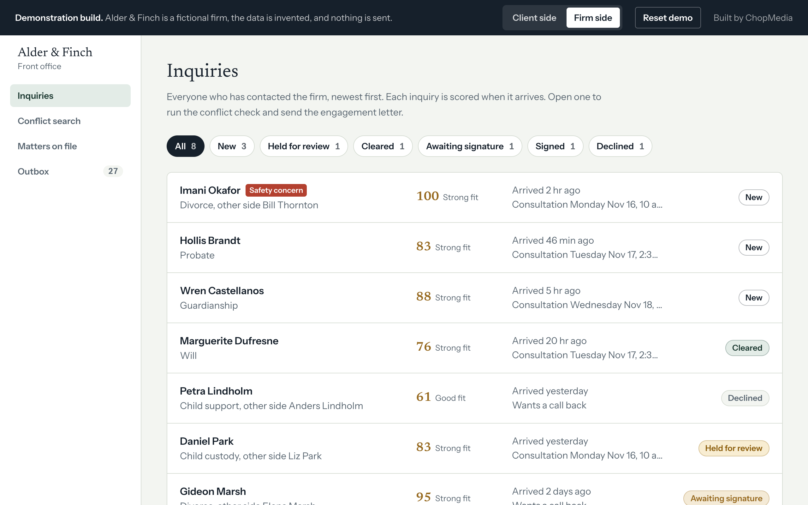
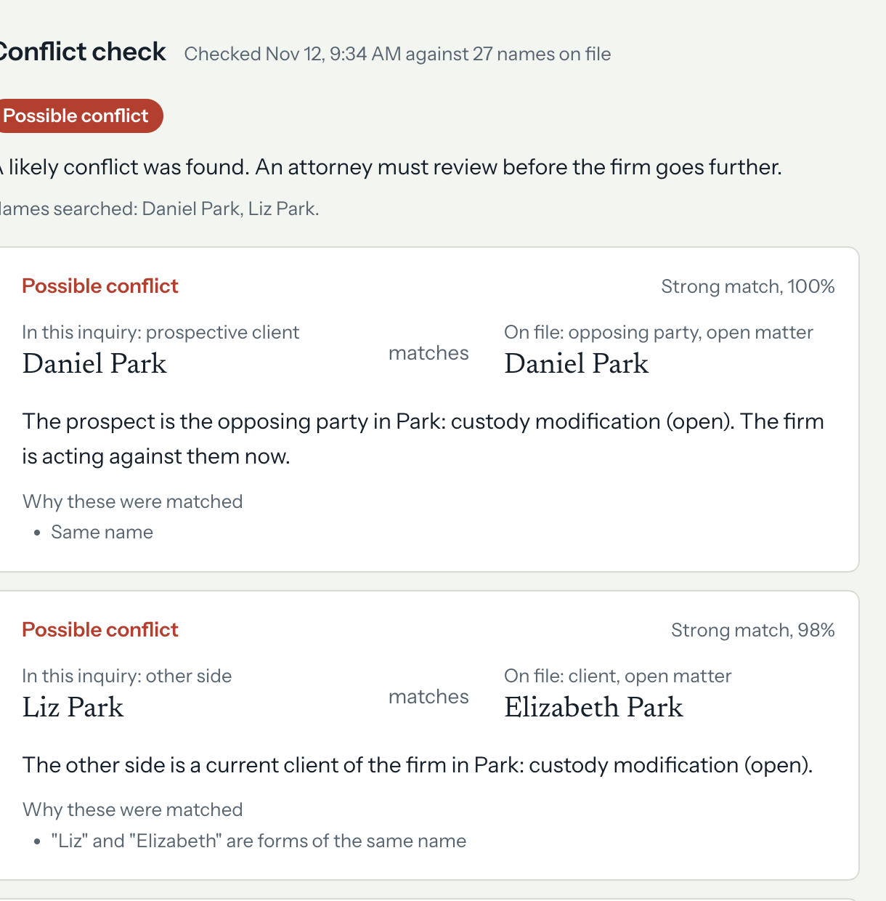
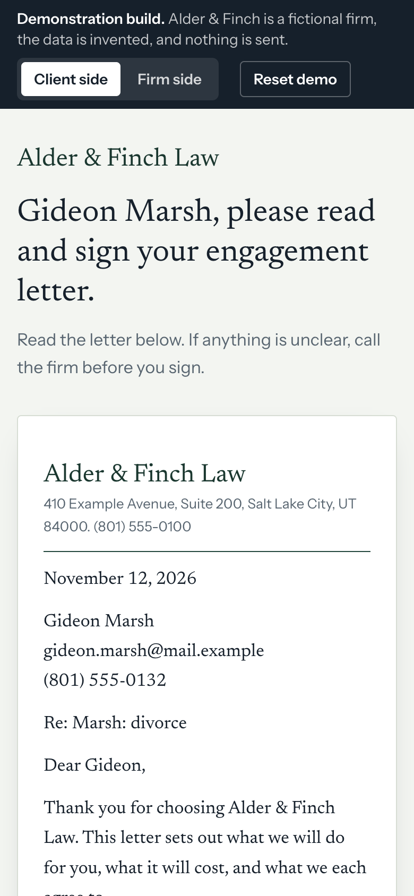

# Law firm front office

New inquiries answered, checked for conflicts and signed up as clients, without anyone at the firm retyping a thing.

> **Demo project.** This is a demonstration build by ChopMedia, not client work. Alder & Finch Law is a fictional firm. Every person, matter, phone number and email address in it is invented, and nothing is ever sent to anyone.



**Live demo:** _link to be added once deployed_

## The problem

A small firm loses new clients in the gap between "someone filled in the contact form" and "someone signed an engagement letter". The inquiry sits in an inbox. Somebody calls back and asks the same questions again. The conflict check is a search through a spreadsheet, or memory. The letter is last month's Word file with the names swapped. Then everything is typed a second time into the practice management system.

Each step is small. Together they are days of delay and several places for a mistake that matters, such as taking a call from the other side of a case the firm is already in.

## What it does

- **Takes the inquiry in a chat on the firm's website.** It asks what a receptionist would ask, books a consultation, and is built to decline legal questions and point the visitor to a consultation instead. A visitor who mentions danger is given emergency numbers and moved to the top of the firm's list.
- **Scores each inquiry** with a short set of written rules the firm can read and change, and shows exactly why it scored the way it did.
- **Checks for conflicts of interest** against every client, opposing party and related name on file. It catches nicknames, former names, misspellings and business names written differently, and explains each match. It finds matches for a lawyer to assess. It does not decide whether a conflict exists.
- **Prepares the engagement letter** from the firm's template with the inquiry's details filled in, and sends it for signature.
- **Collects the signature** on a phone or a computer, typed or drawn, and produces a signed PDF with a record of who did what and when.
- **Opens the matter** and shows the exact requests that would create the client and matter in Clio, and every email and text message that would have gone out.

## Try it

Three things worth clicking first:

1. On the client side, play **A conflict of interest**. Then switch to **Firm side**, open Marcus Bell, and run the conflict check. The other side gave her name as Kate Reyes. The firm knows her as Katherine O'Malley-Reyes, a current client.
2. Open **Gideon Marsh**, whose letter is waiting for signature, and choose **Play the client** to sign it. Then open the signed PDF.
3. Open the **Outbox** to see everything the system would have sent along the way.

**Reset demo** in the top bar puts everything back.

| The conflict check | Signing on a phone |
| --- | --- |
|  |  |

## How it would plug into a real firm

The demo stands alone so that anyone can try it. In a real installation:

- **Practice management.** Clients, matters and parties are read from the firm's system (Clio, MyCase, PracticePanther and similar) instead of sample data, and signed matters are written back. The demo records the Clio requests it would make instead of sending them.
- **Email and text messages.** Sent through the firm's own providers. The demo writes them to the outbox instead.
- **E-signature.** The built-in signing page can stay, or be replaced with DocuSign or Dropbox Sign where a firm already pays for one.
- **The chat.** The demo runs on written rules, so it behaves the same way every time and costs nothing to run. The part that reads a visitor's message sits behind one small interface, so a language model can be put there to cope with free-form answers, while the questions asked, the refusal to give advice and everything after the chat stay as written rules.
- **Templates, scoring rules and fee schedules** are the firm's own. The letters here are illustrations, not legal forms.
- **Staff sign-in and permissions.** The demo has none, because every visitor gets a private copy of the sample data.

## What this demo is not

- It is not legal advice. The assistant declines legal questions using written rules, which catch the common phrasings and not every possible one. A real installation would be tested against the firm's own transcripts.
- The engagement letters are sample text, not forms to be used.
- The signing flow shows how signing works. It makes no claim about meeting any particular e-signature law, which would be reviewed for a real firm.
- There are no usage numbers, clients or testimonials, because it is a demonstration.

## Tech stack and architecture

Next.js 16 (App Router, React 19, TypeScript), Tailwind CSS 4, Drizzle ORM on Postgres, pdf-lib, Zod, Vitest.

```
src/
  app/                  pages: client site, firm side (/staff), signing (/sign), PDF route
  components/           chat, signature pad, letter, navigation
  lib/
    chat/               the intake conversation: engine, advice guardrail, scripted scenarios
    conflicts/          name normalization, nicknames, similarity, the conflict check
    documents/          letter templates and PDF generation
    scoring.ts          lead scoring rules
  server/
    workflow.ts         every state change: intake, check, decision, letter, signature, matter
    actions.ts          thin server actions over the workflow
  db/                   schema, seed data, per-visitor sandboxes
```

Decisions worth knowing about:

- **The core logic is plain functions with tests.** Conflict matching, scoring, the chat engine and the workflow do not depend on Next.js, and the workflow tests run against a real in-memory Postgres.
- **Every visitor gets their own sandbox.** A cookie names a private copy of the sample data, created on first visit and deleted after 48 hours, so visitors to a public demo cannot see or disturb each other. One consequence: a signing link only opens in the browser that created it.
- **No paid services and no keys.** Email, text messages and Clio are recorded in an outbox table instead of being called. There is no language model in the demo.
- **Postgres both ways.** Locally the app runs on an embedded Postgres (PGlite) stored in `.data/`, so there is nothing to install. With `DATABASE_URL` set it uses a normal Postgres server with the same schema and queries.

## Run it locally

Needs Node.js 20.9 or newer.

```bash
npm install
npm run dev
```

Open http://localhost:3000. The database is created and filled with sample data on first visit. No settings are required.

```bash
npm test            # unit and workflow tests
npm run typecheck
npm run lint
npm run db:reset    # delete the local database and start fresh
```

To use a Postgres server instead of the embedded database, set `DATABASE_URL` to its connection string and run `npm run db:migrate`.

---

Built by ChopMedia. Contact: _add email and website here_
